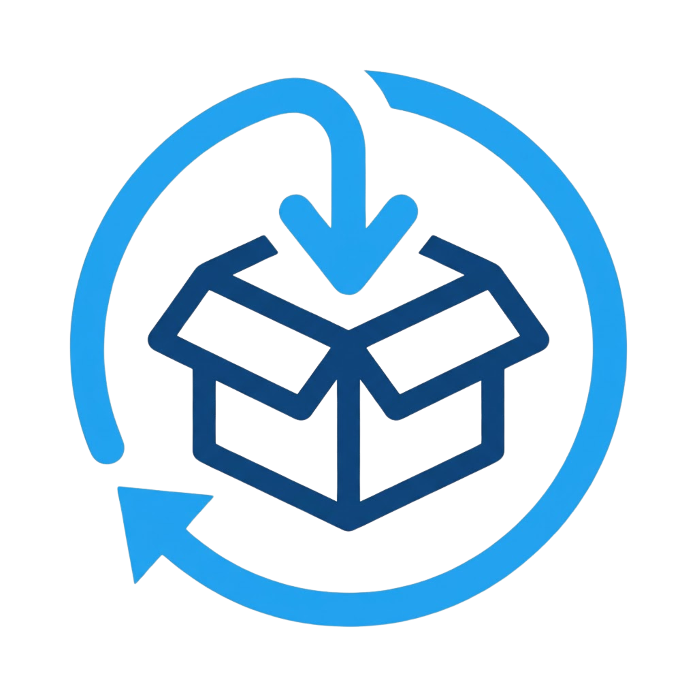
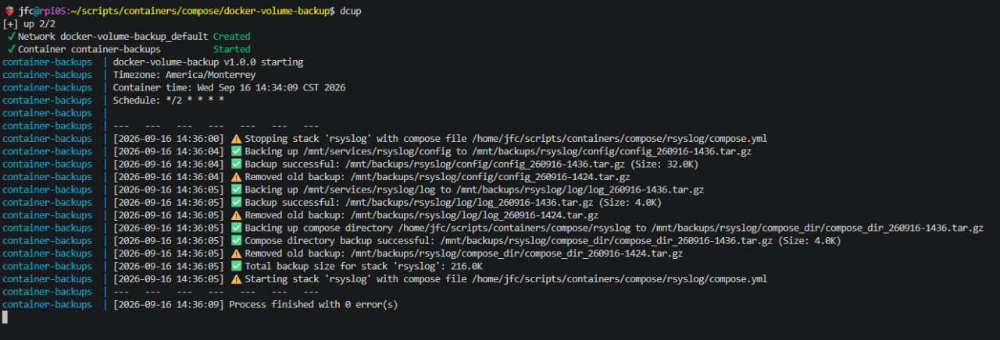

# docker-volume-backup

<p align="center">
  
</p>

Backs up Docker volumes and `docker-compose.yml` files as `.tar.gz` archives, organized by stack. Runs as a Docker container with a configurable cron schedule — no host dependencies, no sudo required.

<div align="center">


</div>

## Table of Contents

- [Features](#features)
- [Quick Start](#quick-start)
- [Configuration](#configuration)
  - [Environment Variables](#environment-variables)
  - [Volumes](#volumes)
  - [config.json](#configjson)
- [How it Works](#how-it-works)
- [Usage](#usage)
  - [Viewing Logs](#viewing-logs)
  - [Running a Backup Manually](#running-a-backup-manually)
  - [Recovery](#recovery)
- [Screenshots](#screenshots)
  - [Backup Folder Structure](#backup-folder-structure)
  - [Telegram Notifications](#telegram-notifications)
- [Migrating from v1.x to v2.0.0](#migrating-from-v1x-to-v200)
- [Changelog](#changelog)

---

## Features

- Backs up Docker volumes **by stack** (not by individual container)
- **Stops the entire stack** with `docker compose down` before backup, restarts with `docker compose up -d` after
- Compresses backups as `.tar.gz` archives **preserving file ownership** (UIDs/GIDs)
- Rotates old backups per volume, configurable with `maxBackups`
- Backs up the **entire folder containing the compose file**, not just the file itself
- Supports per-volume delay before backup (`preBackupSleep`) — useful for database flushes
- Logs backup size per volume and total per stack
- Logs the stacks detected in config.json at the start of every run, confirming exactly which configuration was used
- Sends Telegram notifications (messages + log file), with optional thread support
- Routes success and error notifications to separate Telegram chats/threads, with the option to suppress success notifications entirely to cut down on noise — error notifications are always sent regardless, so a misconfiguration can't leave you blind to real failures
- Validates config.json on every run before touching any stack — logs the error (visible via `docker logs`) and exits without stopping anything if the file is missing or not valid JSON
- Multi-arch image: `linux/amd64` and `linux/arm64` (Raspberry Pi, Oracle Ampere, x86)

---

## Quick Start

```yaml
# docker-compose.yml
services:
  container-backups:
    image: mrcaringi/docker-volume-backup:latest
    container_name: container-backups
    hostname: myserver          # shown in Telegram notifications
    restart: always
    environment:
      CRON_SCHEDULE: "0 2 * * *"
      TZ: "Europe/Madrid"
    volumes:
      - /var/run/docker.sock:/var/run/docker.sock
      - ./config:/config:ro
      - /path/to/backups:/backup
      # Mount stack directories at the same path used in config.json
      - /home/user/docker/stacks:/home/user/docker/stacks:ro
```

```bash
docker compose up -d
docker compose logs -f
```

---

## Configuration

### Environment Variables

| Variable | Required | Default | Description |
|---|---|---|---|
| `CRON_SCHEDULE` | Yes | `0 2 * * *` | Cron expression for backup schedule |
| `TZ` | No | `UTC` | Timezone for log timestamps and backup filenames (e.g. `America/Monterrey`, `Europe/Madrid`) |

> Verify your cron expression at [CRONTAB GURU](https://crontab.guru/)

### Volumes

| Container path | Description | Required |
|---|---|---|
| `/var/run/docker.sock` | Docker socket — needed to stop/start stacks | Yes |
| `/config` | Directory containing your `config.json` | Yes |
| `/backup` | Backup destination directory | Yes |
| `<stack paths>` | Directories containing your stacks' compose files and volumes | Yes |

> **Path mapping:** `docker compose -f <path>` is resolved from inside the container, not from the Docker daemon. Paths in `config.json` must be accessible inside the container. Mount your stack directories at the same path as they appear in `config.json`.
>
> Example: if `config.json` references `/home/user/stacks/myapp/docker-compose.yml`, add this to your volumes:
> ```yaml
> - /home/user/stacks:/home/user/stacks:ro
> ```

> **Mount a directory, not a file:** `/config` must be a directory bind mount (e.g. `./config:/config:ro`), not a single-file mount. Docker's single-file bind mounts track the original inode — if the host-side `config.json` is replaced via rename (common for editors doing atomic saves, `mv`, `scp`, or sync tools), the container keeps serving the old, deleted inode's content indefinitely, even though `container-backups.sh` already re-reads the file on every run. A directory mount avoids this entirely: config changes take effect on the very next scheduled run, no container restart required.

### config.json

```json
{
    "config": {
        "BackupDestination": "/backup"
    },
    "telegram": {
        "APIkey": "your-bot-api-key",
        "SuccessNotification": {
            "enabled": true,
            "ChatID": "your-chat-id",
            "MessageThreadID": "123"
        },
        "ErrorNotification": {
            "ChatID": "your-chat-id",
            "MessageThreadID": "123"
        }
    },
    "stacks": [
        {
            "name": "stack1",
            "composeFile": "/home/user/stacks/stack1/docker-compose.yml",
            "volumes": [
                {
                    "path": "/home/user/stacks/stack1/data",
                    "maxBackups": 5,
                    "preBackupSleep": 10
                },
                {
                    "path": "/home/user/stacks/stack1/config",
                    "maxBackups": 3
                }
            ]
        },
        {
            "name": "stack2",
            "composeFile": "/home/user/stacks/stack2/docker-compose.yml",
            "volumes": [
                {
                    "path": "/mnt/services/stack2/config",
                    "maxBackups": 3
                }
            ]
        }
    ]
}
```

| Parameter | Type | Description |
|---|---|---|
| `config.BackupDestination` | path | Maps to `/backup` inside the container |
| `telegram.APIkey` | string | Telegram bot API key |
| `telegram.SuccessNotification.enabled` | boolean | *(Optional, defaults to `true`)* Set to `false` to suppress the "all OK" message and log file entirely |
| `telegram.SuccessNotification.ChatID` | string | Telegram chat/group ID for success notifications |
| `telegram.SuccessNotification.MessageThreadID` | string | *(Optional)* Thread ID for success notifications |
| `telegram.ErrorNotification.ChatID` | string | Telegram chat/group ID for error notifications — always sent, cannot be suppressed |
| `telegram.ErrorNotification.MessageThreadID` | string | *(Optional)* Thread ID for error notifications |
| `stacks[].name` | string | Stack name — used as subfolder in the backup destination |
| `stacks[].composeFile` | path | Path to the compose file *(as seen inside the container)* |
| `stacks[].volumes[].path` | path | Volume directory to back up *(as seen inside the container)* |
| `stacks[].volumes[].maxBackups` | number | How many backups to keep per volume |
| `stacks[].volumes[].preBackupSleep` | number (sec) | *(Optional)* Wait before backup — useful for DB flushes |

---

## How it Works

For each stack defined in `config.json`:

1. Stop the stack: `docker compose -f <composeFile> down`
2. For each volume (optionally waiting `preBackupSleep` seconds):
   - Compress the volume directory as `<volume-name>_<timestamp>.tar.gz`
3. Compress the folder containing the compose file as `compose_dir_<timestamp>.tar.gz`
4. Rotate old backups according to `maxBackups`
5. Log the backup size per volume and total for the stack
6. Start the stack: `docker compose -f <composeFile> up -d`
7. Send Telegram notification with result and log file

Errors are counted and reported in the final Telegram notification. If a stack fails to stop, it is skipped and the process continues with the next stack.

---

## Usage

### Viewing Logs

```bash
docker logs -f container-backups
```



### Running a Backup Manually

To trigger a backup immediately without waiting for the cron schedule:

```bash
docker exec container-backups /usr/local/bin/container-backups.sh /config/config.json
```
```bash
docker run --rm \
  -e CRON_SCHEDULE="*/2 * * * *" \
  -v /home/user/stacks/docker-volume-backup/testconfig:/config:ro \
  -v /home/user/stacks:/home/user/stacks:ro \
  -v /mnt/backups:/mnt/backups \
  -v /mnt/services:/mnt/services:ro \
  -v /var/run/docker.sock:/var/run/docker.sock \
  mrcaringi/docker-volume-backup:latest \
  /usr/local/bin/container-backups.sh \
  /config/config.json
```

### Recovery

#### 1. Inspect the backup

```bash
tar -tvf stack1_volume1_250902-1900.tar.gz
```

#### 2. Stop the stack

```bash
docker compose -f /path/to/compose.yml down
```

#### 3. Extract the backup

Root is required to restore original file ownership:

```bash
sudo tar -xzpf /path/to/backup/stack1/volume1/volume1_250902-1900.tar.gz \
  --same-owner \
  -C /destination/path
```

#### 4. Start the stack

```bash
docker compose -f /path/to/compose.yml up -d
```

---

## Screenshots

### Backup Folder Structure


### Telegram Notifications


---

## Migrating from v1.x to v2.0.0

**Breaking change:** the `telegram` block in `config.json` was restructured to support separate success/error destinations. The flat `telegram.ChatID` and `telegram.MessageThreadID` fields no longer work.

Before (v1.x):
```json
"telegram": {
    "ChatID": "your-chat-id",
    "APIkey": "your-bot-api-key",
    "MessageThreadID": "123"
}
```

After (v2.0.0):
```json
"telegram": {
    "APIkey": "your-bot-api-key",
    "SuccessNotification": {
        "enabled": true,
        "ChatID": "your-chat-id",
        "MessageThreadID": "123"
    },
    "ErrorNotification": {
        "ChatID": "your-chat-id",
        "MessageThreadID": "123"
    }
}
```

A `config.json` still using the old schema is detected on every run and the script aborts before touching any stack — check `docker logs` for a message pointing back to this section. No Telegram alert is sent in that case, since the broken telegram config is exactly what can't be read.

---

## Changelog

See [CHANGELOG.md](CHANGELOG.md).
